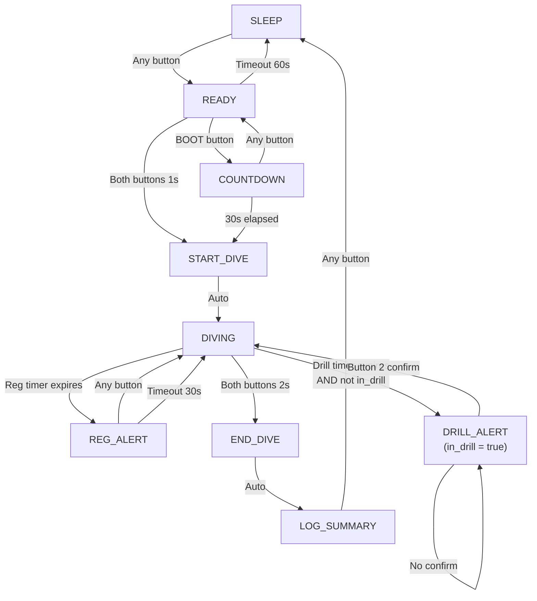

# Dive Trainer Brief

A wearable training device for **technical divers** that prompts regulator switches and random skill drills during training dives.

## Hardware Overview

| Component | Spec |
|-----------|------|
| Board | Adafruit ESP32-S3 Reverse TFT Feather (52×23×9.7mm) |
| Enclosure | Standard GoPro housing (~40-50m rated) |
| Buttons | 2 (GoPro's native buttons) |
| Battery | Small LiPo, 1-2 hour runtime |
| Extras | Vibration motor module, 3D printed packer |

## Core Features

### 1. Regulator Switch Reminders

- Configurable interval (set via Bluetooth before dive)
- Distinct vibration pattern (e.g., long-short-long)

### 2. Random Drill System

- Drills triggered at random intervals
- **Completion must be confirmed** before next drill can trigger (prevents overlap)
- Weighted drill selection configured via phone/Bluetooth
- Distinct vibration pattern from reg switch (e.g., rapid pulses)

Example drills:

- Get out wetnotes, write down the time, and replace
- Mask flood and clear
- Mask remove/replace (full cycle)
- Simulate freeflow (breathe from freeflowing reg)
- OOG approach to buddy (without signaling)
- Valve shutdown drill
- Back kick 2m
- Deploy and re-stow long hose
- Switch to backup torch until the next drill
- Helicopter turn 180° (both directions)
- Isolator shutdown drill
- Left post shutdown + switch reg
- Right post shutdown + switch reg
- Feather a simulated leak
- Gas switch simulation (hand on stage)
- Check all SPGs, note pressures mentally
- Calculate rock bottom (mental math)
- Reel management (deploy 3m, retrieve)
- 360° scan (check surroundings)
- Team check (locate all team members)
- EDGE check (End, Depth, Gas, Environment)
- Touch contact navigation 10 seconds (eyes closed)

### 3. Display & Timer

- **Elapsed timer with seconds** displayed on screen. between drills this is large, taking up the full screen
- **Start method options**:
  - Press both GoPro buttons simultaneously (through housing)
  - OR press onboard BOOT button before sealing housing
- High contrast: **orange background, black text**
- **Reg switch timer** at the 5 minute mark, the screen flashes a pink background, the content doesn't change, just the background colour
- **Current drill text** displays until marked as complete by diver. Time with seconds is still displayed, just much smaller

### 4. Interaction Model

- Specific button confirms/dismisses (not any-button)
- Must press button to log drill complete → system tracks "in drill" state
- drill time starts when the alarm goes off, stops when top button is pressed
- Both-button simultaneous press = start dive / end dive

### 5. Bluetooth Connectivity

- Configure drill list + waits
- Set reg switch interval
- Download dive log post-dive

### 6. Post-Dive Log

- Simple: drill name + elapsed timestamp for each completed drill

## Out of Scope (MVP)

- Mounting solution (TBD)
- O2 analyzer integration (separate device)
- Real-time clock / wall-clock time (using elapsed timer instead)

---

## Bill of Materials (BOM) — Core Electronics Australia

All parts available from [core-electronics.com.au](https://core-electronics.com.au)

### Core Electronics

| Part | SKU | Qty | Price (AUD) | Stock |3D Model | Datasheet/Docs |
|------|-----|-----|-------------|-------|----------|----------------|
| **Adafruit ESP32-S3 Reverse TFT Feather** | [ADA5691](https://core-electronics.com.au/adafruit-esp32-s3-reverse-tft-feather-4mb-flash-2mb-psram-stemma-qt.html) | 1 | $44.15 | ✅ In stock | [STEP files (GitHub)](https://github.com/adafruit/Adafruit_CAD_Parts/tree/main/5691%20Feather%20ESP32%20S3%20Reverse%20TFT) | [Pinout PDF](https://github.com/adafruit/Adafruit-ESP32-S3-Reverse-TFT-Feather-PCB/blob/main/Adafruit_ESP32-S3_Reverse_TFT_Feather_Pinout.pdf), [EagleCAD](https://github.com/adafruit/Adafruit-ESP32-S3-Reverse-TFT-Feather-PCB) |
| **LiPo Battery 1100mAh** (51×30×6mm) | [CE04377](https://core-electronics.com.au/polymer-lithium-ion-battery-1000mah-38458.html) | 1 | $8.65 | ✅ In stock |Tactile Button 6mm | — | [Omron B3F Datasheet (PDF)](https://cdn-shop.adafruit.com/datasheets/B3F-1000-Omron.pdf) |
| **Gravity Vibration Motor Module** | [DFR0440](https://core-electronics.com.au/gravity-vibration-motor-module-for-arduino.html) | 1 | $4.30 | ✅ In stock | — | [DFRobot Wiki](https://wiki.dfrobot.com/Vibration_Motor_Module__SKU__DFR0440_) (22×27mm PCB) |
| **Tactile Button 6mm tall** (10 pack) | [ADA1490](https://core-electronics.com.au/tactile-switch-buttons-6mm-tall-x-10-pack.html) | 1 | $4.90 | ✅ In stock | — | 51×30×6mm (from product listing) |

*The Gravity motor module includes motor + driver circuit — no separate transistor needed!*

### Battery Options (size vs runtime trade off)

| Capacity | SKU | Price | Approx. Dimensions | Runtime Est. |
|----------|-----|-------|-------------------|--------------|
| 400mAh | [CE04375](https://core-electronics.com.au/polymer-lithium-ion-battery-400mah-38456.html) | $5.55 | 35×25×5mm | ~2-3 hours |
| **1100mAh** | [CE04377](https://core-electronics.com.au/polymer-lithium-ion-battery-1000mah-38458.html) | $8.65 | 51×30×6mm | ~6-8 hours |
| 2000mAh | [CE04378](https://core-electronics.com.au/polymer-lithium-ion-battery-2000mah-38459.html) | $14.45 | 60×36×6mm | ~12+ hours |

### Enclosure & Mechanical

| Part | Est. Price | Notes |
|------|------------|-------|
| **GoPro Hero Housing** | ~$40-60 | Standard 40m rated, Hero 5/6/7/8 sizes vary |
| **3D Printed Packer** | ~$2 filament | PLA body, TPU button contacts recommended |
| **Silicone bumpers/pads** | ~$2 | Button cushioning for tolerance |

### Total Estimated Cost (Core Electronics)

| Category | Cost (AUD) |
|----------|------------|
| ESP32-S3 Feather | $44.15 |
| Battery (1100mAh) | $8.65 |
| Vibration module | $4.30 |
| Tactile buttons | $4.90 |
| **Electronics Subtotal** | **$62.00** |
| GoPro housing | ~$50 |
| 3D printing + misc | ~$5 |
| **Project Total** | **~$117 AUD** |

---

## Wiring Diagram

```
    SIMPLIFIED WIRING (Using Gravity Motor Module)
    ═══════════════════════════════════════════════

    ┌─────────────────────────────────────────────────────────────┐
    │                    ESP32-S3 Feather                         │
    │                                                             │
    │   D0 ●────────────────┐  (onboard button - BOOT)            │
    │                       │                                     │
    │   D1 ●────────────┐   │                                     │
    │                   │   │                                     │
    │   D2 ●────────┐   │   │                                     │
    │               │   │   │                                     │
    │   D5 ●────┐   │   │   │  (motor signal)                     │
    │           │   │   │   │                                     │
    │  GND ●────┼───┼───┼───┼──────────────────────────┐          │
    │           │   │   │   │                          │          │
    │  3V3 ●────┼───┼───┼───┼───────────────────┐      │          │
    │           │   │   │   │                   │      │          │
    └───────────┼───┼───┼───┼───────────────────┼──────┼──────────┘
                │   │   │   │                   │      │
                │   │   │   │                   │      │
    ┌───────────┼───┼───┼───┼───────────────────┼──────┼──────────┐
    │           │   │   │   │                   │      │          │
    │   GRAVITY MOTOR MODULE (DFR0440)          │      │          │
    │           │   │   │   │                   │      │          │
    │    ┌──────┴───┴───┴───┴───┐               │      │          │
    │    │  SIG  NC  VCC  GND   │               │      │          │
    │    │   ●   ●   ●    ●     │               │      │          │
    │    │   │       │    │     │               │      │          │
    │    │   │       └────┼─────┼───────────────┘      │          │
    │    │   │            └─────┼──────────────────────┘          │
    │    │   │                  │                                 │
    │    │   └──────────────────┼── to D5                         │
    │    │    [Motor]           │                                 │
    │    └──────────────────────┘                                 │
    │                                                             │
    └─────────────────────────────────────────────────────────────┘


    ┌─────────────────────────────────────────────────────────────┐
    │                                                             │
    │   BUTTONS (under GoPro housing buttons)                     │
    │                                                             │
    │    BUTTON 1 (Left)              BUTTON 2 (Right)            │
    │    ┌─────────┐                  ┌─────────┐                 │
    │    │  6mm    │                  │  6mm    │                 │
    │    │ tactile │                  │ tactile │                 │
    │    │  ○───○  │                  │  ○───○  │                 │
    │    └──┬───┬──┘                  └──┬───┬──┘                 │
    │       │   │                        │   │                    │
    │       │   └── to D1                │   └── to D2            │
    │       │                            │                        │
    │       └── to GND                   └── to GND               │
    │                                                             │
    │   Note: Use INPUT_PULLUP in code, buttons connect to GND    │
    │                                                             │
    └─────────────────────────────────────────────────────────────┘


    PHYSICAL LAYOUT (Top View - Inside GoPro Housing)
    ══════════════════════════════════════════════════

    ┌─────────────────────────────────────────────────────────────┐
    │                    GoPro Housing Interior                    │
    │                    71.8mm × 50.8mm × 33.6mm                  │
    │                                                              │
    │   ┌──────────────────────────────────────────────────────┐  │
    │   │                                                      │  │
    │   │  ┌────────┐      ┌─────────────────────────────┐     │  │
    │   │  │Button 1│      │                             │     │  │
    │   │  │ 6mm    │      │     ESP32-S3 Feather        │     │  │
    │   │  └────────┘      │     52mm × 23mm             │     │  │
    │   │                  │                             │     │  │
    │   │                  │  ┌──────────┐               │     │  │
    │   │  ┌────────┐      │  │   TFT    │←── Visible    │     │  │
    │   │  │Button 2│      │  │  Screen  │    through    │     │  │
    │   │  │ 6mm    │      │  │          │    housing    │     │  │
    │   │  └────────┘      │  └──────────┘               │     │  │
    │   │                  │                             │     │  │
    │   │                  └─────────────────────────────┘     │  │
    │   │       │                                              │  │
    │   │       │  ┌───────────────────────────────────────┐   │  │
    │   │       │  │  Gravity Motor    │    400mAh LiPo    │   │  │
    │   │       │  │    Module         │    Battery        │   │  │
    │   │       │  │   ~20×15mm        │    ~35×25×5mm     │   │  │
    │   │       │  └───────────────────────────────────────┘   │  │
    │   │       │                                              │  │
    │   └───────┴──────────────────────────────────────────────┘  │
    │                      3D Printed Packer                       │
    │                                                              │
    └─────────────────────────────────────────────────────────────┘


    SIDE VIEW (Depth Cross-Section)
    ════════════════════════════════

    ┌────────────────────────────────────────────┐
    │ GoPro Housing Shell                        │
    │  ┌──────────────────────────────────────┐  │
    │  │ 3D Packer (PLA)                      │  │
    │  │  ┌────────────────────────────────┐  │  │
    │  │  │ Feather (9.7mm)                │  │  │
    │  │  └────────────────────────────────┘  │  │
    │  │  ┌────────────────────────────────┐  │  │
    │  │  │ Battery (5mm)                  │  │  │
    │  │  └────────────────────────────────┘  │  │     
    │  │  ┌──────────┐  ┌──────────────────┐  │  │
    │  │  │Motor Mod │  │    Air gap       │  │  │
    │  │  └──────────┘  └──────────────────┘  │  │
    │  └──────────────────────────────────────┘  │
    └────────────────────────────────────────────┘
     ◄────────── 33.6mm depth ──────────────────►

    Total internal clearance: ~25-28mm usable
    Components: ~15mm stacked (Feather + Battery)
    Plenty of room!
```

---

## Pin Assignment Summary

| GPIO | Function | Notes |
|------|----------|-------|
| D0 | BOOT Button (onboard) | Can use to start timer before sealing |
| D1 | Button 1 (Left GoPro) | INPUT_PULLUP |
| D2 | Button 2 (Right GoPro) | INPUT_PULLUP |
| D5 | Motor Signal | OUTPUT, drives Gravity module |
| 3V3 | Motor Power | Gravity module VCC |
| GND | Common Ground | Buttons + motor |

---

## Timer Start Methods (No RTC)

Since we're skipping the RTC, here are the options for starting the dive timer:

### Option A: Both-Button Press (Recommended)

- Press both GoPro buttons simultaneously through the sealed housing
- Detected as: `button1.value == False AND button2.value == False`
- Hold for 1 second to confirm (avoid accidental triggers)
- Same gesture ends the dive

### Option B: BOOT Button Before Sealing

- Press the onboard BOOT button (D0) before closing the GoPro housing
- Screen shows "DIVE STARTING IN 30s..." countdown
- Gives you time to seal and submerge
- Simpler detection, but must be done pre-seal

### Option C: Bluetooth Start

- Start dive from phone app before submerging
- Timer begins when "Start Dive" command received
- Cleanest UX but requires phone interaction

**Recommendation**: Implement Option A + Option B. Use BOOT button for initial start (pre-seal), both-button press for emergency restart or end dive.

---

## Vibration Patterns

| Alert Type | Pattern | Duration | Description |
|------------|---------|----------|-------------|
| Reg Switch | `▓░░▓░▓▓▓` | ~1.5s | Long-short-long |
| Drill Prompt | `▓░▓░▓░▓░▓` | ~1.0s | Rapid 5 pulses |
| Drill Confirmed | `▓▓` | ~0.5s | Single long pulse |
| Dive Started | `▓▓▓` | ~0.3s | Quick triple |
| Low Battery | `▓░▓` | ~0.4s | Two short pulses |

---

## State Machine



---

## Next Steps

1. **Order parts from Core Electronics** — See BOM above (~$59 electronics)
2. **Get GoPro housing** — Measure exact internal dimensions
3. **Design 3D packer** — CAD with button posts aligned to housing buttons
4. **Prototype wiring** — Test on desk before final assembly
5. **Port code** — Adapt state machine from existing O2 analyzer
6. **Implement timer** — `time.monotonic()` based elapsed timer
7. **Add vibration patterns** — PWM control of motor module
8. **Add BLE config** — Phone app for drill weights & settings

---

## Code Notes

### Timer without RTC

```python
import time

dive_start_time = None

def start_dive():
    global dive_start_time
    dive_start_time = time.monotonic()

def get_elapsed():
    if dive_start_time is None:
        return 0
    return time.monotonic() - dive_start_time

def format_elapsed(seconds):
    mins = int(seconds // 60)
    secs = int(seconds % 60)
    return f"{mins:02d}:{secs:02d}"
```

### Both-Button Detection

```python
BOTH_BUTTON_HOLD_TIME = 1.0  # seconds
both_pressed_start = None

def check_both_buttons():
    global both_pressed_start
    
    if not button1.value and not button2.value:  # Both pressed (active low)
        if both_pressed_start is None:
            both_pressed_start = time.monotonic()
        elif time.monotonic() - both_pressed_start >= BOTH_BUTTON_HOLD_TIME:
            both_pressed_start = None
            return True  # Both held for required time
    else:
        both_pressed_start = None
    
    return False
```

---

## References

- [Adafruit ESP32-S3 Reverse TFT Pinout](https://learn.adafruit.com/adafruit-esp32-s3-reverse-tft-feather)
- [Core Electronics ESP32-S3 Product Page](https://core-electronics.com.au/adafruit-esp32-s3-reverse-tft-feather-4mb-flash-2mb-psram-stemma-qt.html)
- [DFRobot Gravity Vibration Motor Wiki](https://wiki.dfrobot.com/Vibration_Motor_Module__SKU__DFR0440_)
- [CircuitPython time.monotonic()](https://docs.circuitpython.org/en/latest/shared-bindings/time/index.html)
- [CircuitPython PWM](https://learn.adafruit.com/circuitpython-essentials/circuitpython-pwm)
