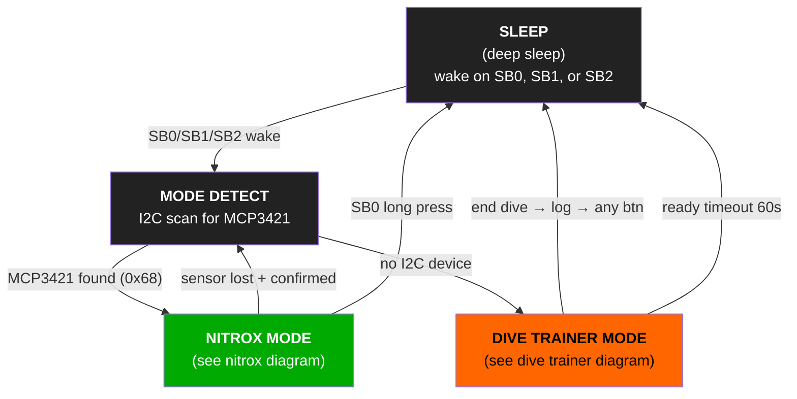
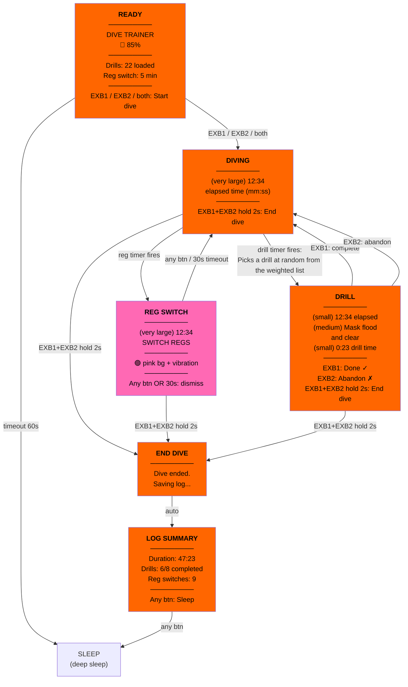

# BDSM Dive computer

A single Adafruit ESP32-S3 Reverse TFT Feather inside a GoPro housing that serves as both a **nitrox analyser** (topside) and a **dive training device** (underwater). The O2 sensor lives in a separate 3D-printed enclosure connected via TRRS cable.

## Design Principles

- **One device, two modes** — the modes are temporally exclusive (analyse gas topside, then seal and dive)
- **Auto-detect mode** — sensor plugged in → nitrox mode; sensor absent → dive trainer mode
- **No power cycle to switch** — unplug the sensor cable and the system transitions to dive trainer mode automatically
- **Distinct visual identity per mode** — different colour schemes so the current mode is immediately obvious

---

## Hardware

### Main Unit (inside GoPro housing)

| Component | Spec | Notes |
|-----------|------|-------|
| Board | Adafruit ESP32-S3 Reverse TFT Feather (ADA5691) | **Must be S3** for BLE support |
| Battery | 1100mAh LiPo (CE04377, 51×30×6mm) | ~6-8 hour runtime |
| Vibration motor | Gravity Vibration Motor Module (DFR0440) | Dive training alerts; available for future nitrox use |
| External buttons | 2× tactile 6mm (ADA1490) | Through GoPro housing buttons |
| TRRS jack breakout | SparkFun TRRS Jack Breakout (BOB-11570) | Internal to housing; wired to Feather I2C + power |
| 3D packer | PLA body, TPU button contacts | Holds everything aligned inside the GoPro housing |

### Sensor Unit (separate 3D-printed enclosure, topside only)

| Component | Spec | Notes |
|-----------|------|-------|
| O2 sensor | Narked at 90 NANM01 (or equivalent) | Molex connector |
| ADC | MCP3421 18-bit (ADA5870) | Built-in PGA (gain 8× = ±256mV), screw terminals for sensor, STEMMA QT for I2C |
| TRRS jack | SparkFun TRRS Jack Breakout (BOB-11570) | In sensor enclosure; wired to MCP3421 I2C header |
| Connector | TRRS male-male cable (~15cm) | Carries I2C (SDA, SCL) + power (3V3, GND) |
| Enclosure | 3D-printed (PLA) | No waterproofing needed — topside use only |

### Why MCP3421 over analog amp

The raw O2 sensor output is ~7–13mV (air). Rather than amplifying this to an analog voltage and sending it over a cable (noise-prone), the MCP3421 in the sensor enclosure digitises at 18-bit resolution right at the source. Its built-in PGA at gain 8× reads ±256mV directly — more than enough for the O2 sensor's full range — so no external op-amp is needed. The I2C digital signal is immune to cable noise.

The MCP3421 breakout (ADA5870) has screw terminals for the sensor leads and a STEMMA QT connector for I2C out. The TRRS cable carries 4 conductors between the sensor enclosure and main unit:

| TRRS conductor | Signal |
|----------------|--------|
| Tip | SDA |
| Ring 1 | SCL |
| Ring 2 | 3V3 |
| Sleeve | GND |

Both ends use a SparkFun TRRS Jack Breakout (BOB-11570) wired to header pins, connected by a short male-male TRRS cable. This makes both ends cleanly disconnectable.

### TRRS Hot-Plug Protection

TRRS connectors have a wipe pattern during insertion/removal: the tip drags across all contacts sequentially, momentarily shorting SDA→SCL→3V3→GND. This can lock the I2C bus or briefly short 3V3 to GND.

**Mitigation:** 220Ω series resistors on the SDA, SCL, and 3V3 lines between the Feather and Jack Breakout #1 (main unit side). GND is connected directly. During the insertion wipe, 3V3 shorting through 220Ω to GND draws only ~15mA — harmless. I2C operates fine through 220Ω series resistance (well within the 300Ω spec limit). The 3 resistors can live inline on the wires or on a tiny piece of perfboard inside the GoPro housing.

**I2C bus recovery:** If the bus locks after a plug event, the firmware should attempt a bus recovery (9 clock pulses on SCL with SDA released) before the next I2C scan. CircuitPython's `busio.I2C` handles this automatically on `i2c.try_lock()`.

**Operational note:** The sensor cable is only connected/disconnected topside with the GoPro housing open. Hot-plugging is an expected scenario (unplug sensor to switch to dive trainer mode without power cycling).

### Sensor detection

The system detects whether the sensor is connected by attempting an I2C scan for the MCP3421's address (0x68 default). If the device responds, the sensor is present → nitrox mode. If not, dive trainer mode. This check runs:

- At boot
- Periodically while in nitrox mode (detect unplug → auto-switch to dive trainer)
- The I2C scan is non-destructive and takes <1ms
- **Debouncing:** a single failed scan does not trigger SENSOR_LOST. The sensor must fail to respond on **3 consecutive scans** (~1.5s at 2Hz polling) before the system considers it disconnected. This prevents false triggers from cable wiggle or momentary I2C bus glitches during hot-plug.

---

## GPIO Pin Assignment

| Pin | Function | Logical Name | Mode |
|-----|----------|-------------|------|
| BOOT (D0) | Onboard button 1 | **SB0** | Both (wake from sleep) |
| D1 | Onboard button 2 | **SB1** | Nitrox (calibrate / navigate) |
| D2 | Onboard button 3 | **SB2** | Nitrox (history / sleep) |
| D9 | External button 1 (top GoPro) | **EXB1** | Nitrox (freeze/save); Dive trainer (confirm/dismiss) |
| D10 | External button 2 (side GoPro) | **EXB2** | Dive trainer (confirm/dismiss) |
| D5 | Vibration motor signal | — | Dive trainer (alerts); available for nitrox |
| I2C (SDA/SCL) | MCP3421 via TRRS + MAX17048 (onboard) | — | Nitrox (sensor) + both (battery) |
| 3V3 / GND | Motor module + sensor power via TRRS | — | Both |

All 5 buttons available topside (housing open). Only EXB1 + EXB2 accessible underwater (through GoPro housing buttons). SB0 can be pressed before sealing.

---

## Colour Schemes

| Mode | Background | Text | Rationale |
|------|-----------|------|-----------|
| Nitrox analyser | Green (`0x00AA00`) | White (`0xFFFFFF`) | Oxygen/gas association; good topside visibility |
| Dive trainer | Orange (`0xFF6600`) | Black (`0x000000`) | High underwater contrast per dive trainer brief |
| Sleep / mode select | Dark grey (`0x222222`) | White (`0xFFFFFF`) | Low power draw; neutral |

Colour schemes configurable via BLE app in future.

---

## Screen Orientation

The 240×135 TFT is landscape orientation (240 wide × 135 tall). The screen faces outward through the GoPro housing's back door (where the GoPro's own touchscreen/LCD would be). Pixel (0,0) is at the **top-left** corner of the display as viewed through the housing.

From the diver's perspective (looking at the back of the housing):

- **Top edge** (240px wide): nearest to EXB1 (top GoPro button)
- **Left edge** (135px tall): nearest to EXB2 (side GoPro button)
- **SB0/SB1/SB2** (onboard buttons): along the right edge of the screen, accessible only with housing open

---

## State Machine

### Buttons

- SB0, SB1, and SB2 are the buttons directly on the feather, next to the screen
- EXB1 and EXB2 are the buttons that are passed through by the GoPro housing. EXB 1 is the button the top of the GoPro, and EXB2 is the button on the side.

### Screen Layout Conventions

#### EXB button labels

Whenever an EXB button has a function on screen, its label is displayed **aligned with the physical button position** so the diver doesn't have to think:

- **EXB1** (top of GoPro housing): label displayed at the **top of the screen**, horizontally
- **EXB2** (left side of GoPro housing): label displayed on the **left edge of the screen**, rotated 90° to read upward (matching the button's physical position)

This convention applies to all dive trainer screens. Examples:

```
DRILL screen:                    DIVING screen:
    ┌───────────────────┘└─────┐    ┌───────────────────┘└─────┐
    │          [Complete]↑EXB1 │    │                          │
    │┌───────┐                 │    │                          │
    ││       │  12:34          │    │                          │
   ┌┘│Abandon│  Mask flood     │    │         12:34            │
   └┐│       │  and clear      │    │                          │
    ││       │                 │    │                          │
    │└───────┘  0:23           │    │                          │
    │  ← EXB2 (rotated 90°)    │    │                          │
    └──────────────────────────┘    └──────────────────────────┘
```

When no EXB function exists for a screen (e.g., DIVING idle, REG_ALERT), the labels are simply not shown. The hold-both-to-end-dive gesture is not labelled on screen — it's a learned interaction.

### Combined Top-Level Flow



### Nitrox Mode (5 buttons, topside, green scheme)

```mermaid
flowchart TD
    N_ANALYSE["<b>ANALYSE</b><br/>─────────<br/>O₂: 32.1%<br/>MOD 1.4: 33m<br/>MOD 1.6: 40m<br/>Bat: 85% &bull; Cal: #7<br/>─────────<br/>SB1: Calibrate<br/>SB2: History<br/>SB0: Sleep"]

    N_UNCALIBRATED["<b>ANALYSE (uncalibrated)</b><br/>─────────<br/>UNCALIBRATED<br/>Raw ADC: 1247<br/>Bat: 85%<br/>─────────<br/>SB1: Calibrate<br/>SB0: Sleep"]

    N_CALIBRATE["<b>CALIBRATE</b><br/>─────────<br/>Raw ADC: 1247 (live)<br/>─────────<br/>SB1: Lock air cal (20.9%)<br/>SB2: Lock 100% cal<br/>SB0: Back"]

    N_CAL_CONFIRM["<b>CAL SAVED</b><br/>─────────<br/>✓ Air cal locked<br/>Raw: 1247 → 20.9%<br/>(1.5s then auto-return)"]

    N_HISTORY["<b>HISTORY</b><br/>─────────<br/>#  O₂%  MOD<br/>7  32.1  33m<br/>6  21.0  57m<br/>...<br/>─────────<br/>SB1: Scroll ▲<br/>SB2: Back<br/>SB0: Scroll ▼"]

    N_ANALYSE -->|SB1| N_CALIBRATE
    N_ANALYSE -->|SB2| N_HISTORY
    N_ANALYSE -->|"EXB1: freeze + save"| N_ANALYSE
    N_ANALYSE -->|"SB0 (long press)"| SLEEP
    N_ANALYSE -->|"60s inactivity"| SLEEP
    N_ANALYSE -->|"sensor lost (I2C timeout)"| N_SENSOR_LOST

    N_UNCALIBRATED -->|SB1| N_CALIBRATE
    N_UNCALIBRATED -->|"SB0 (long press)"| SLEEP
    N_UNCALIBRATED -->|"60s inactivity"| SLEEP
    N_UNCALIBRATED -->|"sensor lost (I2C timeout)"| N_SENSOR_LOST
    N_UNCALIBRATED -->|"calibration exists"| N_ANALYSE

    N_CALIBRATE -->|"SB1: save air cal"| N_CAL_CONFIRM
    N_CALIBRATE -->|"SB2: save 100% cal"| N_CAL_CONFIRM
    N_CALIBRATE -->|"SB0: cancel"| N_ANALYSE

    N_CAL_CONFIRM -->|"1.5s auto"| N_ANALYSE

    N_HISTORY -->|SB1| N_HISTORY
    N_HISTORY -->|SB2| N_ANALYSE
    N_HISTORY -->|SB0| N_HISTORY

    N_SENSOR_LOST["<b>SENSOR LOST</b><br/>─────────<br/>Sensor disconnected.<br/>Switch to Dive Trainer?<br/>─────────<br/>SB1: Yes<br/>SB2: No (stay)"]
    N_SENSOR_LOST -->|SB1| MODE_DETECT
    N_SENSOR_LOST -->|SB2| N_ANALYSE

    MODE_DETECT["MODE_DETECT<br/>(scan I2C)"]
    SLEEP["SLEEP<br/>(deep sleep)"]

    style N_ANALYSE fill:#00AA00,color:#fff
    style N_UNCALIBRATED fill:#887700,color:#fff
    style N_CALIBRATE fill:#00AA00,color:#fff
    style N_CAL_CONFIRM fill:#00AA00,color:#fff
    style N_HISTORY fill:#00AA00,color:#fff
    style N_SENSOR_LOST fill:#AA4400,color:#fff
```



**Notes:**

- **EXB1** in nitrox mode: **freeze/save** — press EXB1 to freeze the current reading on screen and append it to the nitrox log. The display shows "SAVED ✓" for 1.5s alongside the frozen values (O₂%, MOD). Press any button to unfreeze and return to live readings. If the reading hasn't fully settled, the save still captures whatever value is shown — the user decides when it's good enough.
- **EXB2** in nitrox mode: unassigned. Available for future use (e.g., toggle MOD PPO₂ display).
- The ANALYSE screen refreshes the sensor reading continuously (~2Hz). No button press needed to take a reading. Readings are **not auto-saved** — only EXB1 freeze/save writes to the log.
- Long-press SB0 for sleep prevents accidental sleeps when navigating.
- **Inactivity timeout:** 60s with no button press in any nitrox state → auto-sleep. The timeout resets on any button press. This prevents battery drain if the device is left on after analysis.
- **First boot / no calibration**: if no calibration file exists, the system enters the UNCALIBRATED variant of ANALYSE. It shows the raw ADC value and battery but cannot display O₂% or MOD. History is disabled (SB2 does nothing). The user must calibrate before meaningful readings are possible. After the first calibration, the system transitions to normal ANALYSE.

### Dive Trainer Mode (2 buttons underwater, orange scheme)



**Notes:**

- **No deep sleep during dive trainer mode.** Once the dive starts (DIVING state), the device stays awake continuously until the dive ends and the log summary is dismissed. Deep sleep only occurs from READY timeout (60s) or after LOG_SUMMARY → any button.
- **Deep sleep wake:** only SB0, SB1, and SB2 can wake from deep sleep (all three are RTC-capable GPIO on the ESP32-S3). EXB1/EXB2 (D9/D10) are RTC-capable but are not configured for wake — the device is always woken topside with the housing open, then sealed for underwater use.

### Dive Trainer: Timer & Event Detail

#### Native state

The screen on the dive trainer will show time elapsed since the dive started (triggered manually) in minutes and seconds (both equally prominent). If the dive time is longer than an hour, it will show the hour at the start of the time. It doesn't need to have two digits' space allocated as nobody will ever take this on a 10 hour+ dive.

#### Reg switch (orthogonal timer)

The reg switch is a **repeating timer** that fires at a fixed interval (default 5 min) from dive start. It's not a state in the traditional sense — it **overlays** on whatever state the diver is currently in.

**Reg switch during DIVING (no active drill):** Full-screen REG_ALERT: pink bg, vibration, "SWITCH REGS" text. Dismissed by any button or 30s timeout → back to DIVING.

**Reg switch during a DRILL:** Drills are either **interruptible** or **non-interruptible**. This is a property of each drill, configured in the drill list.

| Drill type | Reg switch behaviour | Example |
|------------|---------------------|---------|
| **Interruptible** | Pink bg overlay + vibration for **20s**. Drill text stays visible. Dismiss by pressing **both EXB1+EXB2 briefly** (without triggering end-dive), or wait for 20s auto-dismiss. Individual button presses (EXB1 alone = complete drill, EXB2 alone = abandon drill) still work as normal during the overlay. | Deploy backup torch, 360° scan, team check |
| **Non-interruptible** | Reg switch is **deferred**. No alert fires. As soon as the drill is completed or abandoned, a single deferred reg switch fires as a full REG_ALERT. If multiple reg intervals passed during the drill, only one alert fires — the diver already knows they've been on one reg for a while. | Valve shutdown, mask remove/replace, isolator shutdown, freeflow sim |

In both cases, the **drill timer keeps running**. The reg switch doesn't pause drill time — sometimes it do be like that.

**Example: non-interruptible drill with deferred reg switch**

```
12:00  DIVING (idle)
12:34  drill_start: "Valve shutdown drill" (non-interruptable)
15:00  reg timer fires → deferred (drill in progress, non-interruptable)
15:47  drill_complete: "Valve shutdown drill" (drill time: 3:13)
15:47  REG_ALERT fires immediately (deferred switch)
15:52  diver dismisses → DIVING
```

**Example: interruptible drill with reg switch**

```
12:00  DIVING (idle)
12:34  drill_start: "Deploy backup torch" (interruptable)
15:00  reg timer fires → pink bg overlay + vibration (drill stays on screen)
15:20  bg returns to orange after 20s auto-dismiss (drill still active, timer still counting)
15:20  drill_complete: "Deploy backup torch" (drill time: 2:46)
15:20  DIVING (idle)
```

#### Drill interruptibility config

Each drill in the drill list has an `interruptable` flag:

```json
{"name": "Valve shutdown drill", "weight": 1.0, "interruptable": false}
{"name": "Deploy backup torch", "weight": 1.0, "interruptable": true}
{"name": "Mask remove/replace", "weight": 1.0, "interruptable": false}
{"name": "360° helicopter turn", "weight": 1.0, "interruptable": true}
```

Sensible defaults: anything involving gas management, mask, or valve manipulation is non-interruptible. Observation/awareness drills are interruptible.

#### Reg switch timing

Reg switches fire on **absolute intervals** from dive start (e.g. 5:00, 10:00, 15:00). They are never delayed or rescheduled — if the diver ignores a REG_ALERT and it auto-dismisses at 4:45, the next one fires at 5:00 as normal. This is intentional: gas consumption doesn't pause because you're busy, and stacking up missed switches is realistic training for managing gas imbalance.

During a non-interruptible drill that spans multiple reg intervals, all missed switches collapse into **one** deferred alert on drill completion. Rapid-fire buzzing after a hard drill is counterproductive.

#### Low battery indicator

Battery percentage is shown on the DIVING screen. If battery drops below 30%, the battery % text is displayed with a **red background** as a visual warning. No vibration or state change — it's the diver's responsibility to manage battery before the dive.

#### Drill text display

Drill names use a **smaller font** to fit the 240×135 screen. Long names word-wrap. The elapsed timer and drill timer remain at their standard sizes; only the drill name text scales down.

#### Drill scheduling

| Parameter | Default | Configurable via BLE |
|-----------|---------|---------------------|
| Min interval between drills | 3 min | Yes |
| Max interval between drills | 8 min | Yes |
| Next drill delay | Random uniform between min and max | — |

- A new drill timer starts when the previous drill is **completed or abandoned**, not when it was triggered
- Drills **cannot fire** while `in_drill == True`
- Drill selection is weighted random (no immediate repeats)
- An abandoned drill **can** be selected again later in the dive — it wasn't completed, so it's still in the pool
- Drill timer does **not** pause for reg switch alerts — drill time includes everything that happens during the drill

#### Both-button detection

The "end dive" gesture (EXB1+EXB2 hold 2s) must work from any diving state. Implementation:

```txt
every loop iteration:
    if EXB1 pressed AND EXB2 pressed:
        if both_pressed_start is None:
            both_pressed_start = now
            suppress_individual = True
        elif now - both_pressed_start >= 2.0s:
            → END_DIVE
    else:
        if suppress_individual:
            if now - both_pressed_start < 2.0s:
                # Released before 2s — dismiss reg overlay if active,
                # otherwise discard (incomplete end-dive attempt)
                pass
            suppress_individual = False
        both_pressed_start = None
        # Only now process individual EXB1/EXB2 presses
```

This runs at the top of the event loop, before any state-specific button handling. The 2s hold prevents accidental triggers.

**Key behaviour:** any time both buttons are detected as pressed simultaneously, individual presses are **suppressed** until both are released. This prevents a staggered press (EXB1 100ms before EXB2) from registering as a single EXB1 tap. The ~20ms debounce loop rate is fast enough to catch near-simultaneous presses.

- Both held ≥2s → end dive
- Both pressed and released <2s → if interruptible reg overlay is showing, dismiss it; otherwise ignored
- Single button press (other button not touched) → normal action after one loop iteration confirms the other button isn't also pressed

#### Edge case: ending dive during a drill

If the diver ends the dive while a drill is active, the log will contain a `drill_start` event with no matching `drill_complete` or `drill_abandon`. This is detected when reading the log back:

```
{"t": 342, "event": "drill_start", "name": "Mask flood and clear"}
{"t": 2847, "event": "dive_end"}
```

No completion or abandonment for "Mask flood and clear" → it was interrupted by end of dive. This is distinct from an explicit abandon — the diver didn't choose to skip it, the dive just ended.

#### Drill abandonment

EXB2 during an active drill abandons it. The drill is logged as abandoned and the system returns to DIVING.

```
{"t": 342, "event": "drill_start", "name": "Mask flood and clear"}
{"t": 355, "event": "drill_abandon", "name": "Mask flood and clear"}
```

**Behaviour after abandonment:**

- The drill timer for the *next* drill starts immediately (same as after completion)
- The abandoned drill stays in the weighted pool — it can come up again later
- If the same drill is abandoned repeatedly, that's useful training data (e.g., "I abandoned mask drills 3 times → my eyes were bothering me")

**LOG_SUMMARY tracks three drill outcomes:**

| Outcome | How detected in log | Example display |
|---------|--------------------|-----------------|
| Completed | `drill_start` followed by `drill_complete` | ✓ Mask flood (0:45) |
| Abandoned | `drill_start` followed by `drill_abandon` | ✗ Mask flood (0:13) |
| Interrupted | `drill_start` with no completion/abandon before `dive_end` | ⚠ Valve shutdown |

#### Logging strategy

Events are appended to the dive NDJSON file as they occur (see Data Storage section for format). The file is opened, a single line written, and closed immediately. This minimises the window for filesystem corruption on power loss.

The LOG_SUMMARY screen is the only point where the file is read back — to compute stats for display.

---

## Calibration

### Approach

Two-point calibration stored in NVM (non-volatile memory on the ESP32-S3 filesystem):

1. **Air calibration** (20.9% O2) — the common case, always available
2. **100% O2 calibration** — optional, for higher accuracy across the full range

A single-point calibration on air is sufficient for recreational nitrox analysis (21–40% O2). The 100% point improves accuracy for trimix/heliox analysis if needed later.

### Storage

Calibration data saved as a JSON file on the CircuitPython filesystem:

```json
{
    "cal_air_raw": 1234,
    "cal_air_o2": 20.9,
    "cal_100_raw": null,
    "cal_100_o2": 100.0,
    "cal_count": 7
}
```

- Persists across reboots and mode switches
- Analyse screen shows a "last calibrated" indicator (e.g., `Cal: #7` or a staleness warning if `cal_count` is 0)
- Recalibrating on air overwrites `cal_air_raw`; recalibrating on 100% overwrites `cal_100_raw`

### Calibration Screen (Nitrox Mode)

```
┌──────────────────────────┐
│ [SB1] CALIBRATE           │
│                          │
│  Current reading: 1247   │
│  (raw ADC value)         │
│                          │
│  ► Air (20.9%)    [SB1]   │
│  ► 100% O2        [SB2]   │
│  ► Back           [SB0]   │
│                          │
│  Last cal: Air #7        │
└──────────────────────────┘
```

The screen shows the live raw ADC value so you can see when the reading has stabilised before pressing the button to lock in the calibration.

---

## Data Storage

Two separate stores on the CircuitPython filesystem. Both use **NDJSON** (newline-delimited JSON) — one JSON object per line, appended as each event occurs. This means a crash or power loss loses at most the last partial line, not the whole session.

### Nitrox History (`/data/nitrox_log.ndjson`)

Each reading is appended as a single line when the analyser takes a stable reading:

```
{"o2_pct": 32.1, "mod_14": 33, "mod_16": 40, "cal_num": 7, "reading_num": 1}
{"o2_pct": 21.0, "mod_14": 57, "mod_16": 66, "cal_num": 7, "reading_num": 2}
```

### Dive Training Log (`/data/dive_NNN.ndjson`)

Each file is one dive session (e.g., `dive_003.ndjson`). Events are appended as they happen — the file grows line by line throughout the dive:

```
{"t": 0, "event": "dive_start"}
{"t": 300, "event": "reg_switch"}
{"t": 342, "event": "drill_start", "name": "Mask flood and clear"}
{"t": 355, "event": "drill_abandon", "name": "Mask flood and clear"}
{"t": 600, "event": "reg_switch"}
{"t": 891, "event": "drill_start", "name": "Back kick 2m"}
{"t": 940, "event": "drill_complete", "name": "Back kick 2m"}
{"t": 900, "event": "reg_switch"}
{"t": 1200, "event": "reg_switch"}
{"t": 2847, "event": "dive_end"}
```

`t` is elapsed seconds from dive start. Events are written immediately — if power dies mid-dive, everything up to the last completed write is preserved.

#### Event types

| Event | Written when | Fields |
|-------|-------------|--------|
| `dive_start` | Dive begins (enter DIVING) | `t` |
| `reg_switch` | Reg timer fires | `t` |
| `drill_start` | Drill prompt shown | `t`, `name` |
| `drill_complete` | EXB1 pressed to confirm | `t`, `name` |
| `drill_abandon` | EXB2 pressed to abandon | `t`, `name` |
| `dive_end` | Both-button hold confirmed | `t` |

If a drill has a `drill_start` with no matching `drill_complete`, it was incomplete (diver ended dive mid-drill, or power was lost).

#### LOG_SUMMARY screen

The END_DIVE → LOG_SUMMARY transition reads back the NDJSON file to compute summary stats (duration, drill count, completion rate). This is the only time the file is read during a dive — all other operations are append-only.

LOG_SUMMARY displays **aggregate stats only** (no per-drill scrollable list):

```
Duration: 47:23
Drills: 6 completed, 1 abandoned, 1 interrupted
Reg switches: 9
```

Detailed per-drill analysis is done after downloading the NDJSON file.

#### Storage management

The 4MB flash has limited space. Data files must be periodically cleared:

- **USB download:** the CircuitPython filesystem is a USB mass storage device. Connect to a computer, copy `/data/` contents, delete old files.
- **BLE download (future):** companion app downloads logs and clears them.
- **On-device warning:** if free space drops below 50KB, show a ⚠ "STORAGE LOW" warning on the READY or ANALYSE screen. Refuse to start a new dive log if <10KB free — better to warn than to crash mid-dive.
- **No automatic deletion** — the user explicitly clears data after downloading.

---

## BLE Configuration (Future)

Configurable via a companion phone app:

| Setting | Default | Mode |
|---------|---------|------|
| Drill list + weights | All equal | Dive trainer |
| Reg switch interval | 5 min | Dive trainer |
| Min/max drill interval | 3–8 min | Dive trainer |
| Colour scheme (nitrox) | Green/white | Nitrox |
| Colour scheme (dive) | Orange/black | Dive trainer |
| PPO2 limits for MOD display | 1.4 / 1.6 | Nitrox |

---

## Bill of Materials

### Core Electronics (Australia) — Shopping List

| Part | SKU | Qty | Price (AUD) |
| ------ | ----- | ----- | ------------- |
| Adafruit ESP32-S3 Reverse TFT Feather | ADA5691 | 1 | $44.15 |
| Adafruit MCP3421 18-Bit ADC | ADA5870 | 1 | $14.95 |
| LiPo Battery 1100mAh | CE04377 | 1 | $8.65 |
| SparkFun TRRS 3.5mm Jack Breakout | BOB-11570 | 2 | $15.10 |
| 3.5mm DIY 4-Pole (TRRS) Plug | ADA1799 | 2 | $11.10 |
| Tactile Button 6mm (10 pack) | ADA1490 | 1 | $4.90 |
| Black Soft Caps for Tactile Buttons (10 pack) | CE09218 | 1 | $2.45 |
| Gravity Vibration Motor Module | DFR0440 | 1 | $4.30 |
| **Core Electronics subtotal** | | | **~$105.60** |

### Additional (not from Core Electronics)

| Part | Est. Price (AUD) | Notes |
|------|-------------------|-------|
| O2 sensor (Narked at 90 or equiv.) | ~$80-150 | Molex connector; dive shop or industrial supplier |
| GoPro housing | ~$50 | Standard 40m rated (already owned) |
| 3D printing (2 enclosures + packer) | ~$5-10 | PLA for sensor enclosure, PLA+TPU for GoPro packer |
| Short 4-conductor wire (~15cm) | ~$2 | For making the TRRS male-male cable |
| 220Ω resistors ×3 | ~$1 | Hot-plug protection on SDA, SCL, 3V3 lines |
| STEMMA QT cable (optional) | ~$3 | For breadboard prototyping before TRRS wiring |

### Total Estimated Cost

| Category | Cost (AUD) |
|----------|------------|
| Core Electronics order | ~$106 |
| O2 sensor | ~$80-150 |
| GoPro housing | ~$50 (already owned) |
| 3D printing + misc | ~$15 |
| **Project total** | **~$201-321 AUD** |

---

## Physical Layout

### Main Unit (GoPro Housing Interior)

```
┌─────────────────────────────────────────────────────────────┐
│                    GoPro Housing Interior                   │
│                    71.8mm × 50.8mm × 33.6mm                 │
│                                                             │
│   ┌──────────────────────────────────────────────────────┐  │
│   │                                                      │  │
│   │  ┌────────┐      ┌─────────────────────────────┐     │  │
│   │  │Button 1│      │                             │     │  │
│   │  │EXB1 6mm│      │     ESP32-S3 Feather        │     │  │
│   │  └────────┘      │     52mm × 23mm             │     │  │
│   │                  │                             │     │  │
│   │  TRRS jack       │  ┌──────────┐               │     │  │
│   │  ○ (internal)    │  │   TFT    │← Visible      │     │  │
│   │                  │  │  Screen  │   through     │     │  │
│   │  ┌────────┐      │  │          │   housing     │     │  │
│   │  │Button 2│      │  └──────────┘               │     │  │
│   │  │EXB2 6mm│      │                             │     │  │
│   │  └────────┘      └─────────────────────────────┘     │  │
│   │                                                      │  │
│   │  ┌───────────────────────────────────────────────┐   │  │
│   │  │  Gravity Motor    │    1100mAh LiPo           │   │  │
│   │  │    Module         │    Battery                │   │  │
│   │  │   ~20×15mm        │    51×30×6mm              │   │  │
│   │  └───────────────────────────────────────────────┘   │  │
│   │                                                      │  │
│   └──────────────────────────────────────────────────────┘  │
│                      3D Printed Packer                      │
└─────────────────────────────────────────────────────────────┘
```

### Sensor Unit (3D-Printed Enclosure)

```
┌─────────────────────────────────────────────┐
│         Sensor Enclosure (topside)          │
│                                             │
│   ┌──────────────┐    ┌─────────────────┐   │
│   │  O2 Sensor   │    │   MCP3421       │   │
│   │  (Molex)     │───►│   (screw term)  │   │
│   │              │    │   (ADA5870)     │   │
│   └──────────────┘    └────────┬────────┘   │
│                                │ I2C via    │
│      sensor port     TRRS jack ○ breakout   │
│      (open to air)   (BOB-11570) ──► cable  │
│                                │     to     │
│                                │     main   │
│                                │     unit   │
└─────────────────────────────────────────────┘
```

The sensor enclosure needs an opening for the gas to reach the sensor face — it doesn't need to be sealed.

---

## Wiring Diagram

```
                    ESP32-S3 Reverse TFT Feather
    ┌──────────────────────────────────────────────────────┐
    │                                                      │
    │   BOOT/SB0  ●──── Onboard button 1                   │
    │   D1/SB1    ●──── Onboard button 2                   │
    │   D2/SB2    ●──── Onboard button 3                   │
    │                                                      │
    │   D9/EXB1   ●──── External button 1 ──── GND         │
    │   D10/EXB2  ●──── External button 2 ──── GND         │
    │              (INPUT_PULLUP)                          │
    │                                                      │
    │   D5        ●──── Gravity Motor Module SIG           │
    │   3V3       ●──── Motor VCC                          │
    │   GND       ●──── Motor GND + Button GND             │
    │                                                      │
    │   STEMMA QT ●──┬── SDA ──► Jack Breakout #1 Tip      │
    │              │  └── SCL ──► Jack Breakout #1 Ring1   │
    │   3V3       ●────────────► Jack Breakout #1 Ring2    │
    │   GND       ●────────────► Jack Breakout #1 Sleeve   │
    │                                                      │
    └──────────────────────────────────────────────────────┘
                          │
              TRRS male-male cable (~15cm)
          (2× ADA1799 plugs + 4-conductor wire)
                          │
    ┌──────────────────────────────────────────────────────┐
    │              Sensor Enclosure                        │
    │                                                      │
    │   Jack Breakout #2 ── Tip ────► MCP3421 SDA          │
    │                    ── Ring1 ──► MCP3421 SCL          │
    │                    ── Ring2 ──► MCP3421 VCC (3V3)    │
    │                    ── Sleeve ─► MCP3421 GND          │
    │                                                      │
    │   MCP3421 screw terminal (+) ◄── O2 Sensor (+)       │
    │   MCP3421 screw terminal (−) ◄── O2 Sensor (−)       │
    │                                                      │
    └──────────────────────────────────────────────────────┘
```

**Note:** 220Ω series resistors are placed on the SDA, SCL, and 3V3 lines between the Feather and Jack Breakout #1. GND is connected directly. See [TRRS Hot-Plug Protection](#trrs-hot-plug-protection) for rationale.

---

## Implementation Sequence

1. **Order parts** — S3 Feather, MCP3421, TRRS jack breakouts × 2, TRRS plugs × 2, motor module, buttons, 1100mAh battery
2. **Breadboard prototype** — wire up all components on a breadboard, test I2C to MCP3421 (address 0x68), test button inputs, test motor
3. **Port existing nitrox code to S3** — update pin assignments, replace random readings with MCP3421 reads
4. **Implement sensor detection** — I2C scan for MCP3421 (0x68) for auto mode switching
5. **Implement calibration with NVM** — air + 100% O2, persist to filesystem
6. **Implement dive trainer state machine** — timer, drill system, vibration patterns
7. **Design and print sensor enclosure** — O2 sensor + MCP3421 + TRRS jack breakout
8. **Design and print GoPro packer** — feather + battery + motor + external buttons + internal TRRS jack breakout
9. **Integration testing** — mode switching, calibration persistence, full dive session simulation
10. **BLE configuration** — phone app for drill weights, settings, log download

---

## Open Questions / Future Considerations

- **TRRS cable strain relief** — the cable will be handled frequently when plugging/unplugging. A small strain relief on both enclosures would extend cable life. Hot-plug electrical protection is handled by the series resistors (see [TRRS Hot-Plug Protection](#trrs-hot-plug-protection)).
- **Sensor warm-up** — O2 sensors need ~30s to stabilise after power-on. The analyse screen should indicate when the reading is still settling.
- **Filesystem write safety** — CircuitPython's filesystem can corrupt if power is lost during a write. Writes (cal data, dive logs) should be atomic where possible (write to temp file, rename).
- **Motor driver** — the DFR0440 has an onboard transistor driver, so D5 is a logic-level signal only (no direct motor current through the GPIO). No external capacitor or driver circuit needed.
- **Motor in nitrox mode** — left open; no hardware changes needed to add later. Possible uses: buzz on reading stabilisation, buzz on out-of-range reading.
- **I2C address conflict** — the MAX17048 (battery monitor, address 0x36) and MCP3421 (default 0x68) don't conflict. If future I2C devices are added, check for collisions.
- **BLE dependency** — ~~as of CircuitPython 9.x, BLE was not available on this board due to the 4MB flash limitation.~~ **Resolved: CircuitPython 10.x supports BLE on 4MB ESP32-S3 boards** (firmware partition doubled to 2.8MB). The board download page for CP 10.1.4 (latest stable) lists Bluetooth/BTLE as a supported feature. BLE config app is no longer blocked.
- **CircuitPython 10 setup requirements:**
  - Update TinyUF2 bootloader to 0.33.0+ (latest: 0.35.0) before installing CP10. The old bootloader cannot load the larger firmware.
  - `displayio` API changes: `busdisplay.BusDisplay` replaces `displayio.Display`, `fourwire.FourWire` replaces `displayio.FourWire`. The existing code.py uses old displayio calls and must be updated.
  - `sys.print_exception()` removed — use `traceback.print_exception()`.
